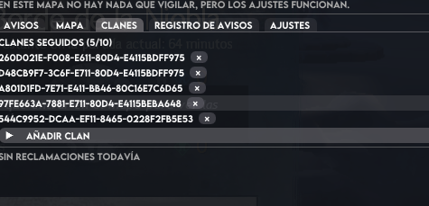
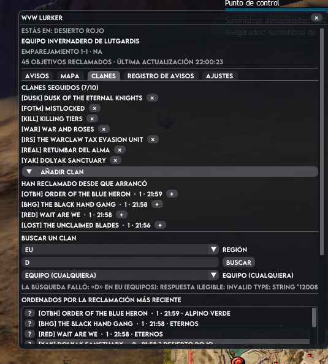
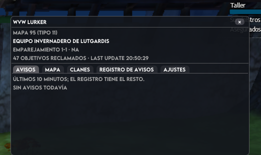

# Bugs

Bandeja de entrada de fallos. **No se borra este fichero**: cada bug se marca como `hecho`
cuando está resuelto, con la versión en la que salió el arreglo.

Formato:

```
## [ ] Título corto (fecha en que se reporta)
- Qué pasa, cómo se reproduce, qué se esperaba.
- **Hecho (versión):** qué se cambió y dónde.
```

Estado: `[ ]` pendiente · `[x]` hecho.

## [x] clanes seguidos no dice el nombre (2026-10-31)

- En «Clanes seguidos» y en la lista de «Añadir clan» los clanes salían como el id crudo
  (`260D021E-F008-…`), imposible de reconocer.
- Causa: los nombres se pedían a `/v2/guild/:id` **solo para los clanes que habían reclamado algo
  en el emparejamiento**, así que un clan seguido que aún no había reclamado nunca se resolvía.
- **Hecho (0.17.1):** `catalog::resolve_guild_names` pide primero los **clanes seguidos** y después
  los del emparejamiento, con el mismo presupuesto por sondeo y la misma caché de sesión. Los que
  la API rechaza se recuerdan para no repetir la petición.

## [x] wdiget - ajustes nombres pequeños (2026-10-31)

- En la pestaña de ajustes los rótulos de la derecha se cortaban («INTERVALO DE SON…»,
  «ALCANCE DE LOS AVISOS»): el control se comía el ancho y el texto quedaba fuera de la ventana.
- Causa: el ancho reservado para los rótulos se calculaba con una **frase larga** (un aviso), no
  con los rótulos que de verdad se dibujan, así que la columna de los controles era enorme.
- **Hecho (0.17.1):** `ui::settings::label_column` mide la columna sobre la lista real de rótulos en
  el idioma activo, y los controles se quedan con el resto (`push_item_width`).

## [ ] avisos no funciona (2026-10-31)
- «En mapa azul he reclamado y no ha saltado el aviso de que he reclamado, aunque tengo marcado
  seguir reclamaciones de mi mapa.»
- **Diagnóstico (0.17.1):** el registro del juego dice que el addon estaba vigilando el
  emparejamiento **`1-1`, que es de Norteamérica**, con el equipo guardado `11011`
  («Lutgardis Conservatory», un equipo NA). Si el jugador está en Europa, el addon nunca ve sus
  capturas: son de otro emparejamiento. Los ids de equipo son de la temporada actual y el nombre
  del equipo no tiene por qué coincidir con el mundo antiguo que uno recuerda (T-45).
- **Hecho (0.17.1) en la parte que se puede arreglar sin el jugador:** la cabecera del widget
  enseña ahora la **región del emparejamiento** («Matchup 1-1 · NA»), se avisa en naranja cuando el
  equipo guardado ya no juega, y el worker escribe una línea por sondeo cuando cambia el
  emparejamiento vigilado (`worker: vigilando …`) más una por evento detectado
  (`evento: Claim … (late: …)`), que es lo que faltaba para distinguir «no llega» de «llega y se
  filtra».
- **Pendiente de confirmar por el jugador:** volver a elegir equipo (Ajustes → Región → Equipo) y,
  si sigue sin saltar, mandar las líneas `evento:` y `worker: vigilando` del `Nexus.log`.

## [x] wdiget - buscador de clanes no muestra nada (2026-10-31)
- El desplegable de equipo no desplegaba nada y escribir una palabra y pulsar «Buscar» no hacía
  nada.
- Causa doble: (1) el bloque exigía **equipo y región**, y los dos se sacaban de la lista de
  equipos vivos, así que con la lista vacía no había ni desplegable ni búsqueda; y (2) dentro de
  WvW la lista de equipos solo se pide si alguien la pide, y este bloque no la pedía.
- **Hecho (0.17.1):** la **región** (la del equipo del jugador) es lo único obligatorio y el equipo
  pasa a ser un filtro opcional («Equipo (cualquiera)», y los resultados enseñan su equipo). El
  bloque pide la lista de equipos al worker mientras está en pantalla y, si aún no ha llegado, lo
  dice en vez de quedarse mudo. El campo de texto va antes del botón.

## [x] Botones de menú escondidos (2026-10-31)
- Con la ventana estrecha las últimas pestañas se quedaban fuera y no había forma de llegar a
  ellas.
- **Hecho (0.17.1):** la barra de pestañas usa `FITTING_POLICY_SCROLL`, así que imgui dibuja las
  flechas de desplazamiento en la propia barra (el «…» que se pedía), como el proyecto hermano.

## [x] widget · registro de avisos no hace limpieza al reiniciar (2026-10-31)
- Al reiniciar el juego, el registro seguía lleno de lo de antes.
- Causa: la línea base de cada sesión marca como `late` todo lo que ya estaba reclamado, y esas
  líneas se enseñaban igual si el clan era seguido, así que hasta 50 filas viejas entraban en el
  registro.
- **Hecho (0.18.0):** un `late` **solo** se enseña si el clan es seguido **y** la captura es de los
  últimos 10 minutos (`alerts::LATE_GRACE`): eso no es lo de ayer, es lo que nos perdimos al
  arrancar. Lo viejo sigue estando en el historial y en la ruta, que es su sitio. Test
  `rf25_a_restart_does_not_refill_the_log_with_yesterdays_claims`.

## [x] widget · clanes seguidos fuera de ajustes y sección de añadir (2026-10-31)
- **Hecho (0.18.0):** la pestaña **Clanes** empieza por **Clanes seguidos** (con la × para dejar de
  seguir) y debajo **Añadir clan**, que abre **los 10 últimos que han reclamado algo** esta sesión
  más el **buscador**. En los ajustes queda una línea que dice dónde está.

## [x] widget · buscador de clanes (2026-10-31)
- a. **falta sección EU/NA** → **hecho (0.18.0):** el buscador empieza por la **región** (EU/NA),
  con la del jugador por defecto y cambiable.
- b. **el desplegable muestra ids numéricos** → **hecho (0.18.0):** `team_label` usa el nombre del
  equipo (`data/wvw-teams.json`) y, si el jugador le puso uno suyo, el suyo; el id va entre
  paréntesis.
- c. **`invalid type string 11004`** → **mitigado (0.18.0):** antes de pedir `/v2/guild/:id` se
  comprueba que el id tenga forma de id de clan (32 hexágonos), así que un id que no lo sea ya no
  gasta una petición ni produce ese error; además el mensaje de fallo dice **qué** se buscó («texto»
  en EU/NA) y **en qué paso** falló (búsqueda o equipos). Si vuelve a salir, el texto dirá de dónde
  viene.

## [x] widget · el doble clic no volvía a descontraer (2026-10-31)
- **Hecho (0.18.0):** la barra de título entera responde al ratón (`invisible_button`), no solo las
  letras, y con la ventana contrada **un solo clic** en la barra la abre: pedir otro doble clic
  sobre una caja de dos centímetros era optimista.

## [x] el atajo de teclado no abre el widget (2026-10-31)
- «La combinación de teclas no abre el widget; lo he probado con diferentes combinaciones y ninguna
  funciona.»
- Causa doble: (1) el atajo **solo alternaba click-through**, así que con la ventana cerrada (que es
  como queda al pulsar `×`) no pasaba nada visible; y (2) el binding se registraba **por cadena**
  (`"CTRL+SHIFT+L"`), y una cadena que el parser de Nexus no acepta se registra en silencio, sin
  avisar.
- **Hecho (0.18.1):** el atajo se registra **por código de tecla** (`Keybind { key: VK_L, ctrl,
  shift }`, sin parser de por medio) y lo que hace es **traer la ventana**: la muestra, la despliega
  y le quita el click-through (`ui::reveal`, con test). El registro deja una línea en el log
  (`atajo registrado: …`) y cada pulsación otra, para no volver a quedarse sin evidencia.

## [x] widget · el horario no coincide con el de España (2026-10-31)
- Las horas se pintaban en **UTC** (la API y el historial van en UTC, que es lo correcto para
  comparar), así que una captura de las 21:40 salía como 19:40.
- **Hecho (0.18.0):** `addon::clock` convierte a la hora local del sistema en el último momento, y
  todas las horas del addon (avisos, registro, clanes, emparejamiento y mapa) pasan por ahí.
  Tests `rf19_the_clock_uses_the_players_timezone_and_not_utc`.

## [x] widget · clic derecho con click-through (2026-10-31)
- «El widget debería poder tener clic derecho aunque tengas click-through, para así poder deshabilitar
  click-through sin tener que abrir ajustes.»
- **Hecho (0.17.3 y 0.17.4):** el callback de render mira el ratón por su cuenta y un clic derecho
  dentro de la caja del widget apaga el click-through y lo guarda. La caja se guarda también en
  click-through, que era lo que faltaba para poder acertar.

## [x] al clicar un clan debería salir su ruta virtual (2026-10-31)
- «Al clicar sobre un clan en un aviso o en un clan que sigo, debería sacar la ruta virtual del
  último mapa en el que ha reclamado algo.»
- **Hecho (0.19.0):** las líneas de aviso y los clanes seguidos son clicables: seleccionan el clan y
  llevan el mapa al **último donde reclamó** (`Dashboard::last_map_of`, que elige por `claimed_at`),
  así que la pestaña Mapa ya dibuja su ruta. Test `t51_clicking_a_guild_knows_its_last_map`.

## [x] el mapa no es real (2026-10-31)
- «El mapa no es real»: seguía saliendo el tablero esquemático aunque **Mapa real** está activado.
- **Hecho (0.20.1):** era un bug de verdad y estaba en el código: el presupuesto de texturas se
  gastaba **una vez por sesión** (el contador no se reiniciaba), así que de las 16 teselas de un mapa
  solo se cargaban 4 y el resto no se dibujaba nunca. Ahora el presupuesto es **por frame** y una
  textura que falle deja un `warn` con su ruta. Comprobado además en tu instalación que la caché es la
  buena (59 ficheros `2-1-*`, «las del mapa ya estaban en caché»).


## [ ] el hover del mapa enseña el id del clan, no su nombre (2026-10-31)
- «Pasar el ratón por encima de un objetivo no dice el nombre del clan sino un id.»
- **Hecho (0.19.0):** `map::detail_line` recibe el mapa de nombres y enseña `[TAG] Nombre`; el id solo
  aparece si la API no lo ha resuelto.

## [x] nombres de los equipos erróneos (2026-10-31)
- «Los nombres actuales traducidos no son correctos. Busca los nombres en inglés de la web que te
  puse, en alemán de la web que te puse; para español e inglés busca si está en `equipos.xlsx` y si no
  está pon el nombre inglés para español y francés, y ya lo traduciré yo.»
- **Hecho (0.20.0):** `data/team-names.json` se rehace leyendo las cuatro páginas de gw2mists con el
  **navegador integrado** (la SPA se ejecuta, así que los nombres se ven; `curl` y su API no). Alemán
  de la web (que no es el del Excel: `Grenths Tür`, `Ettinbuckel`, `Vogelhalle des Großen Hauses`),
  inglés de la tabla de ids, y español/francés del Excel cuando el nombre está en la hoja; el resto en
  inglés. Tus traducciones propias siguen mandando. Ver `07-spikes.md`.


## [ ] avisos y registro · no recoge bien la información (2026-10-31)
- «No sale siempre quién ha reclamado»; «desde las 20:22 no recoge nuevos resultados aunque ha habido
  reclamaciones»; «el registro va lentísimo: que se cargue solo cuando se necesite, máximo 50 filas
  más el historial de los clanes que sigues desde que abriste el juego»; y el formato de la línea.
- Formato pedido para el aviso: **icono del tipo de objetivo**; el mapa con su color («Eternos» en
  gris, «Azul» en azul, «Verde» en verde, «Rojo» en rojo, cada uno con su equivalencia); y en gris el
  nombre del sitio, un guion y **el clan que lo tiene reclamado ahora**, sin perder el clan original
  en el historial de la sesión si era uno seguido.
- **Hecho (0.19.0):** el formato de la línea, con colores por trozo (ver `0.19.0` en `CHANGELOG.md`) y
  el clan actual resuelto a `[TAG] Nombre`.
- Pendiente: «desde las 20:22 no recoge nada» y el rendimiento del registro. Para lo primero, el
  worker ya escribe `worker: vigilando …` y una línea `evento: …` por evento: con ese log de una
  sesión se ve si el sondeo se paró, si el emparejamiento cambió o si el filtro se lo comió. Para lo
  segundo, la lista que se pinta en el registro se puede limitar a las últimas 50 sin tocar el
  historial de la sesión (que es lo que alimenta la ruta).

## [ ] la ventana no se puiede mover
- n otiene ni clocktough ni bloqueada, pero no se mueve
- he instalado la versión niueva y no detecta que he cogido campa y relcaamado, ponew que nadie ha hecho nada en los ultimos 15 minutos desde que mepeceé a jugar ma so menos
- indica "mapa 95" y emparejamiento 1-1

- el boton "x" no cierra la ventana, hace una especie de plegado