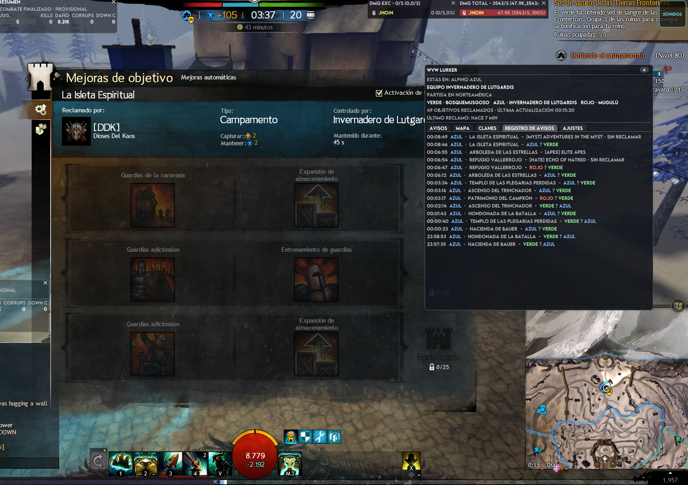

a los 10 o 11 minutos deja de grabar eventos. adjunto ejemplo con pantallazo, donde yo mismo he capturado el campante del norte de mapa azul y no lo ve. se supone que el addon cada 5 segundos busca información SOLO de lo reclamado en mi emparejamiento 

## [x] borrar el json que nadie lee (2026-11-01)
1.- borra el json aquel que nadie lee y elimina su codigo.
- **Hecho (0.24.0):** se va `crates/store` entero: el `session-000.jsonl` no lo leía nadie (la UI
  usa el historial en memoria y ADR-012 borra el fichero al arrancar). También se borra el fichero
  que hubiera en la carpeta del addon.

## [x] nombres de clan en el Bastión y en todas partes (2026-11-01)
2.- en el Bastión los clanes salen con su id largo; si no sabes el nombre, búscalo y caches al settings.
- **Hecho (0.24.0):** `names.rs` guarda `id → [TAG] Nombre` en `guild-names.json` (fuera de
  `settings.json` a propósito: puede tener miles de entradas y `settings.json` se reescribe cada
  vez que se mueve una ventana). Se carga al arrancar y se publica en el dashboard, así que el
  Bastión (donde no se sondea) enseña nombres desde el primer fotograma. Un nombre pedido una vez
  no se vuelve a pedir nunca.

## [x] los segundos del aviso se pierden al reiniciar (2026-11-01)
3.- los segundos de avisos emergentes se pierden en cada reinicio.
- **Hecho (0.24.0):** el saneado del fichero recortaba a **5 s** mientras el control ofrecía 20:
  cualquier valor mayor se guardaba como 5. Ahora el tope es el mismo (`POPUP_SECS_MAX` = 20) y hay
  test con 12 s.

## [x] el atajo del click-through está mal (2026-11-01)
4.- si pulso clickthrough dice que pulse una combinación que no es la correcta.
- **Hecho (0.24.0):** el texto era el literal «CTRL+SHIFT+L». Ahora `keybinds.rs` lee
  `addons/Nexus/InputBinds.json` y enseña lo que Nexus tiene guardado (en tu fichero:
  `Ctrl+Shift` + código 39, que es «;»). Si no se puede leer, se dice el identificador
  `GW2LURKER_CLICK_THROUGH` en vez de inventar una tecla.

## [x] quitar la casilla de click-through de la ventana (2026-11-01)
5.- en widget, ajustes, «ventanas» elimina la opción de click-through; solo el botón derecho.
- **Hecho (0.24.0):** la casilla desaparece de Ajustes → Ventanas; queda el clic derecho sobre el
  widget (y el atajo que tengas en Nexus).

## [x] buscador de clanes: hace falta un índice (2026-11-01)
6.- el buscador no funciona; extrae a un script para probar: «a new» debe encontrar «A new name…»;
    «DIE» debe encontrar varios.
- **Medido (2026-11-01):** `/v2/guild/search?name=` devuelve **un solo** clan y solo cuando el
  texto **empieza** su nombre: `die` → *Die*, `a new` → *A New*, `a ne` → nada, `DIE anmutig` →
  nada. No hay forma de pedirle «todos los que contienen X».
- **Hecho (0.24.0):** la búsqueda real es por **subcadena** sobre la caché de nombres
  (`guild-names.json`), instantánea y sin red; el API añade una coincidencia más. `scripts/guild-search.ps1`
  busca fuera del juego y **construye** el índice (`-BuildIndex -Region eu`), que es lo que hace
  que «DIE» encuentre *Die Quaggans*, *Die Garde*, etc.
- **Pendiente:** el índice hay que construirlo una vez (el script tarda ~10-20 min para una
  región); después se reutiliza para siempre.