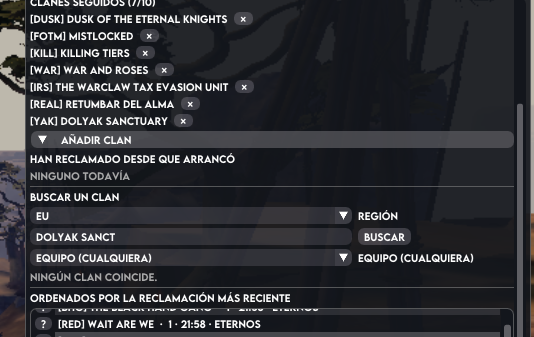

# Bugs

Bandeja de entrada de fallos. **No se borra**: cada bug se queda con su marca. `[x]` cuando creo que
está arreglado, con la versión en la que sale el arreglo, para que el jugador pueda comprobarlo y
tacharlo del todo si quiere.

Formato:

```
## [x] Título corto (fecha en que se reporta)
- Qué pasa, cómo se reproduce, qué se esperaba.
- **Hecho (x.y.z):** qué se cambió y dónde.
- **Pendiente:** qué falta (si falta algo).
```

Estado: `[ ]` pendiente · `[x]` arreglado según el addon (a falta de que el jugador lo confirme).

## [x] «ha dejado de recoger quién reclama» (2026-10-31 22:09)
version 0.22.6. 22:25 en mapa rojo he reclamado hacienda de bahuer con YaK que estaba ya capturado sin reclamar.  3 minutos dpesues aun no ha salido ningun aviso. YaK es un clan que sigo (yo mismo)


MINUTOS MAS tarde se reclama otro campa pro otro clan, y tampoco sale aunque tengo seleccionado ver avisos de lo que pase en mi mapa


- Lo que dice la evidencia del API (2026-10-31, 22:36): en la partida que miraba el addon (`1-1`) el
  **último reclamo era de las 22:02** y durante media hora no hubo **ninguno**, mientras otras
  partidas sí se movían. Es decir: o hay un problema de equipo/partida, o la API no refleja lo que se
  ve en el juego.
- **Hecho (0.22.8):** el addon ahora dice **de dónde cree que eres** y **con quién dice el juego que
  juegas**: `donde: mumble shard …, color …, equipo configurado …, mumble dice …` en el log, y un
  aviso en naranja en la cabecera cuando el equipo guardado no es el que el juego te da. El
  `shard_id` de Mumble no está verificado en WvW (T-19): esta línea es lo que lo resuelve.
- **Pendiente:** que el jugador mire la cabecera la próxima vez y compare con su panel de WvW.
- **Lección del jugador (2026-10-31, 22:46):** NO era «la partida estaba tranquila». Entró con la
  0.22.6, reclamó campa y el addon no lo detectó; minutos después otro clan reclamó otro campa y
  tampoco. Lo que pasó es lo de siempre: el addon vigilaba la partida del **equipo guardado**, y ese
  equipo no era el suyo.
- **Hecho (0.22.9):** la partida se saca **del juego**: `shard_id` de Mumble buscado en `all_worlds`
  de los nueve emparejamientos (`core::detect`), con caché de 15 minutos. La cabecera dice
  `EQUIPO … (lo dice el juego)` y el log `deteccion: el juego dice …, el equipo guardado era …`.
- **Pendiente:** confirmar en el juego que ahora sí avisa de una captura propia. Si el `shard_id` no
  fuera el mundo de WvW, el log lo dirá y la detección caerá al equipo guardado.

## [x] no puiedo eliminar clanes (2026-10-31 22:35)
version 0.22.6. pulsar "x" al lado de un clan no lo borra. deberia preguntar si estas seguro, y eliminarlo de clanes que sigues
- **Hecho (0.22.8):** la confirmación se ve: el clan se sustituye por
  «¿Quitar a *nombre* de los clanes que sigues?» y debajo **Sí, quítalo** / **No, seguir
  siguiéndolo**. Antes la pregunta y los botones iban en la misma línea y los botones se salían por
  la derecha.

## [x] click thoufgh no hace nada (2026-10-31 22:35)
version 0.22.6. bnoton derecho click trghough no activa. actvarlo desde los ajustes si lo marca pero sigue sin hacer nada
- **Hecho (0.22.8):** regresión de 0.22.0. `no_inputs` de la ventana no lo hereda la ventana hija
  donde vive el cuerpo, así que el cuerpo seguía comiéndose los clics aunque la marca estuviera
  puesta. Ahora la hija se crea también con `no_inputs` cuando el click-through está activo.

## [x] bujscador de clanes no funciopna (2026-10-31 22:35)
ejemplo, pongo europa y busco yak ,. mi clan, y dice uqe no existe. si hay varios devveria mostrar todos para elegir. he buiscado otros clanes y no encuentra

- **Hecho (0.22.8):** dos causas. (1) El equipo elegido **descartaba** los resultados: buscar tu clan
  con otro equipo seleccionado decía «no existe». Ahora se enseñan todos los de la región con su
  equipo, los del equipo elegido primero. (2) `/v2/guild/search` busca por el **principio de una
  palabra del nombre**, no por el tag: buscar «yak» no encuentra *Dolyak Sanctuary* (comprobado con
  el API: devuelve otro clan). El mensaje de «no hay resultados» lo explica.
